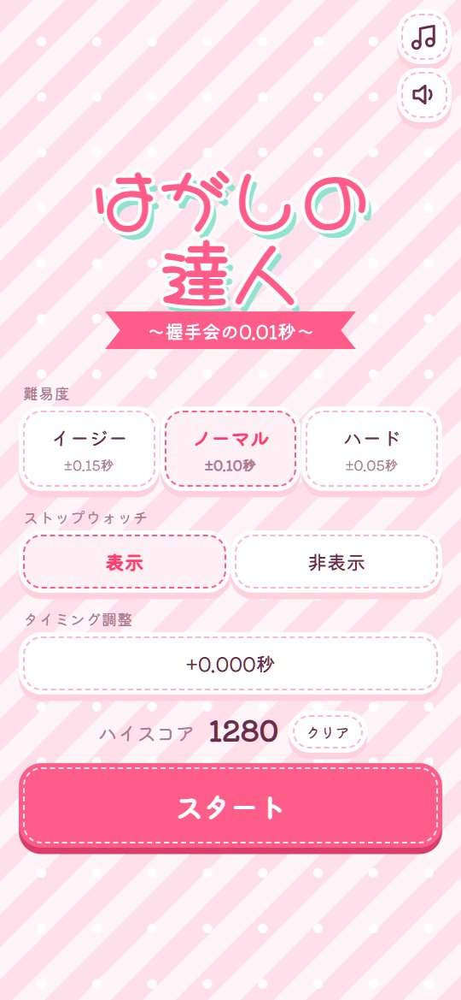
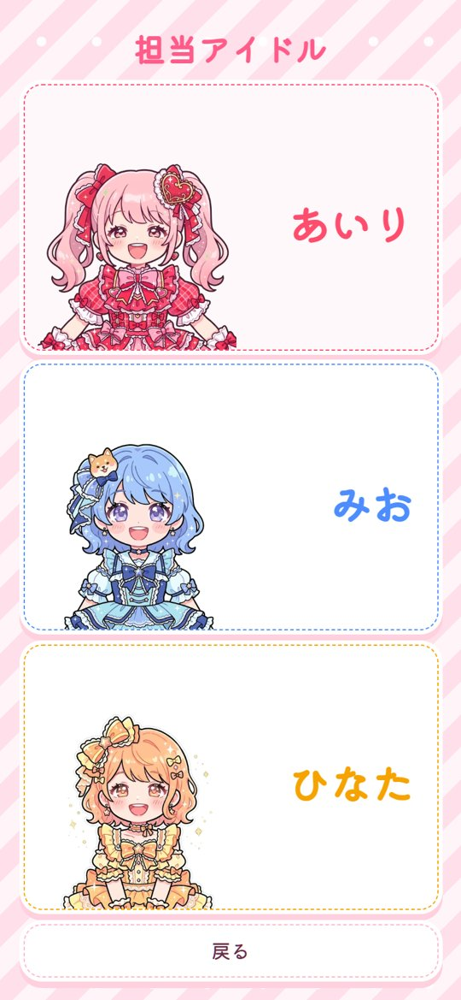
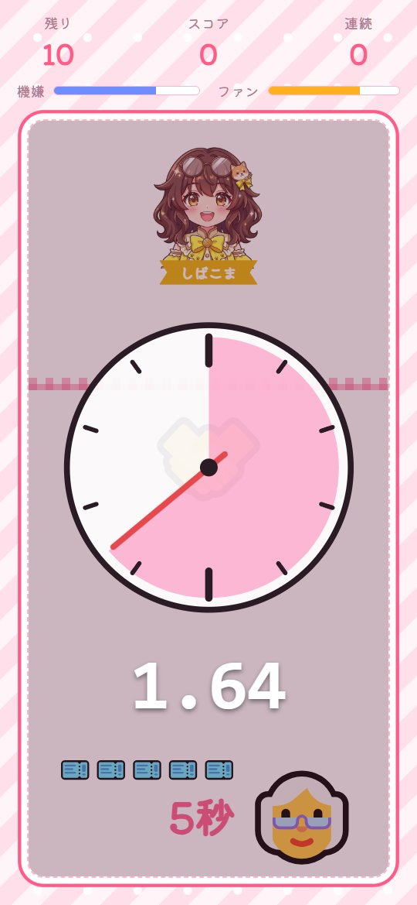
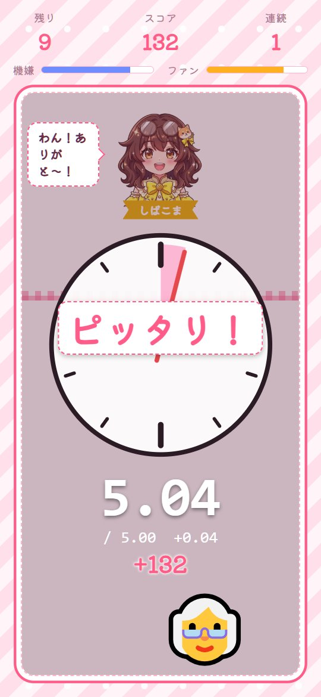
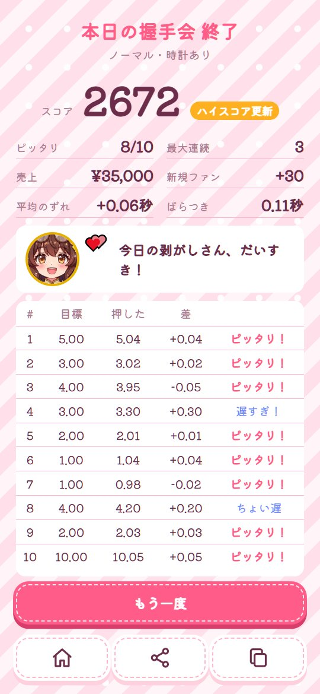

# はがしの達人 〜握手会の0.01秒〜

アイドル握手会の「剥がし」になって、握手の秒数を心の中で数え、**ピッタリの瞬間に剥がす**ブラウザゲームです。
早すぎるとファンが怒り、遅すぎるとアイドルの笑顔の裏で 💢 が増えていきます。

**▶ 遊ぶ: https://yabon3.github.io/hagashi-master/**

スマホでもパソコンでも遊べます（縦長の画面。パソコンでは中央に表示されます）。

| タイトル | 担当アイドル | 握手中 |
|---|---|---|
|  |  |  |

| 判定 | 結果 |
|---|---|
|  |  |

## 遊び方

1. タイトル画面で難易度とストップウォッチの表示を選び、「スタート」
2. 担当アイドルを3人（じゃな子・寒美・しばこま）から選ぶ
3. ファンが握手券を出します。**券1枚＝1秒**
4. ファンの手が近づき、🤝 になった瞬間から心の中で数え始める
5. ここだと思った瞬間に **スペースキー**（スマホは画面をタップ）で剥がす
6. 10人で握手会は終わり。最後は券10枚の「太客」です。結果を見て、ハイスコアを狙いましょう
7. 結果画面の下のボタンは左から「タイトルへ」「結果をシェア」「記録をコピー」。シェアはスマホなら LINE や X に送れます（パソコンでは文章をコピー）

1回はおよそ75秒です。

## 判定

| 難易度 | ピッタリ | ちょい早・ちょい遅 | それより外 |
|---|---|---|---|
| イージー | ±0.15秒 | ±0.375秒 | 早すぎ・遅すぎ |
| ノーマル | ±0.10秒 | ±0.25秒 | 早すぎ・遅すぎ |
| ハード | ±0.05秒 | ±0.125秒 | 早すぎ・遅すぎ |

判定の幅は、握手が1秒でも10秒でも同じです。押さずに待ちすぎると「剥がして！」と怒られます。

## 早すぎと遅すぎ

- **早すぎ** → ファンが怒り、ファンの満足が下がります。結果の売上が減ります
- **遅すぎ** → アイドルの機嫌が下がります。顔はずっと笑顔ですが、本音が顔の横に出ます（💕 → なし → 💦 → 💢 → 💢💢）
- **ピッタリ** → ファンもアイドルも喜びます。続けるほど点数が増えます
- **太客**（最後の1人）は点数が3倍。早すぎ・遅すぎのときの機嫌の下がり方も3倍です

## 担当アイドル

3人とも、50歳前後のおじさんが「ファゴォォォーッ」と叫んで変身したシニアアイドルです。
点数の付き方は3人とも同じです。違うのは台詞と、機嫌の動き方です。（ ）の台詞は心の声、つまり中の人の声です。

| アイドル | 性格 | 機嫌 |
|---|---|---|
| じゃな子 | ジャージ姿の歯笛アイドル。気さくで紳士 | 遅れに寛容。多少長引いても怒らない |
| 寒美 | 見た目はクールビューティ、口を開けば寒いダジャレ | なかなか動かない。💕 を出せたら一人前 |
| しばこま | 愛犬がモチーフ。中身は妄想好きの五十男 | 犬らしく一喜一憂。すぐ 💕、すぐ 💢 |

## ストップウォッチ

「表示」にすると、握手の間だけ大きな時計が出ます。針は**1周で1秒**、通ったところがピンクに塗られます。1秒の長さを体で覚える練習にどうぞ。
「非表示」にすると、時計なしで数える本番です。押したあとに、押した秒数と目標との差が出ます。

ハイスコアは、難易度と時計のあり・なしの組み合わせごとに別々に残ります。友だちと比べるなら「ノーマル・時計なし」がおすすめです。

## タイミング調整

画面の表示やタップの反応には、端末ごとに少し遅れがあります。
タイトル画面の「タイミング調整」で、🤝 の瞬間に12回押すと、その遅れを測って判定から差し引きます。初めて遊ぶ端末では、先に1回やっておくのがおすすめです。

## 操作

| 操作 | 内容 |
|---|---|
| `Space` / `Enter` | 剥がす |
| 画面をタップ・クリック | 剥がす |

## ローカルで動かす

ビルド不要の静的サイトです。`index.html` を開くか、静的サーバーで配信してください。

```bash
python serve.py
# → http://localhost:8123
```

文字の書体（Google Fonts）を読み込むため、インターネット接続があると表示がきれいになります。

## 構成

```
index.html     画面（タイトル／担当アイドル／握手会／結果／タイミング調整）
style.css      レイアウト
theme.css      見た目（リボンとストライプ）
game.js        ゲームの進行・判定・ストップウォッチ
img/           アイドルのイラスト
docs/          この説明の画面写真
serve.py       ローカル確認用のサーバー（ポート8123）
```

## 補足

- 登場するアイドル・ファンはすべて架空です。実在の団体・握手会とは関係ありません
- アイドルの原案は note のシニアアイドル企画です（ご本人の了承を得ています）
  - じゃな子：[山本蛇内さん](https://note.com/joyous_lion93/n/n6f549f2e877a)
  - 寒美：[コーサクさん](https://note.com/moral_mango9195/n/nbd016f2e04ac)
  - しばこま：[しばこま](https://note.com/shibakoma/n/ned8da711c007)
- アイドルのイラストは Google Flow（画像生成）で作りました

## ライセンス

[MIT](LICENSE)
